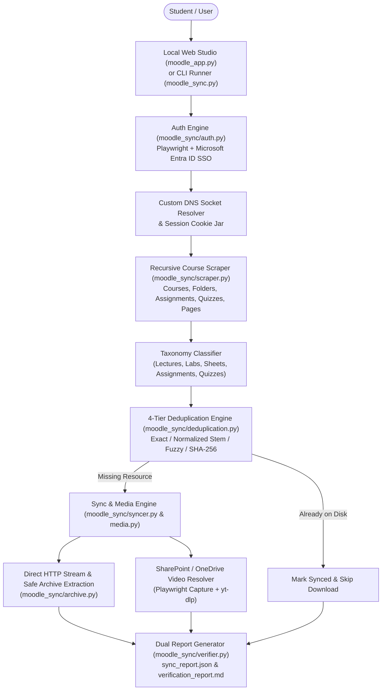

# NU Moodle Sync Studio

[](https://www.python.org/)
[](https://playwright.dev/)
[](https://www.crummy.com/software/BeautifulSoup/)
[](https://requests.readthedocs.io/)
[](https://github.com/yt-dlp/yt-dlp)
[](LICENSE)

**NU Moodle Sync Studio** is an automated course synchronization engine and interactive local web application built for **Nile University's Moodle LMS**. It streamlines academic resource management by authenticating via **Microsoft Entra ID (Azure AD) Single Sign-On**, discovering enrolled courses and nested modules, resolving embedded **SharePoint / OneDrive / Microsoft Stream** lecture recordings, deduplicating against existing local directories, and organizing materials into a clean, standardized folder hierarchy.

---

## Key Features

- **Interactive Web Dashboard & CLI Engine**:
  - Full-featured local web studio (`moodle_app.py`) with real-time progress telemetry, course/category filtering, folder browser, and granular per-file selection.
  - Headless CLI mode (`moodle_sync.py`) supporting `--sync`, `--dry-run`, `--verify`, and single-course filtering for automated workflows.
- **Resilient Microsoft Entra ID (OIDC) Authentication**:
  - Automated Playwright browser authentication handling multi-step Azure AD redirects (`ESTSAUTH`, `MoodleSession`, FedAuth cookies) with intelligent credential validation (instant detection of `AADSTS50126` invalid password, `AADSTS50034` invalid account, and MFA prompts).
  - Custom DNS socket resolver (`MOODLE_IP` override) and Chromium `--host-resolver-rules` integration to bypass local ISP DNS outages seamlessly.
- **4-Tier Intelligent Deduplication Engine**:
  - **Tier 1 (Exact Match)**: Case-insensitive filename and byte-size verification.
  - **Tier 2 (Normalized Stem Match)**: Strips Moodle prefixes (`Lecture_01_`, `[2026FALL]`, timestamps) to match renamed local files.
  - **Tier 3 (Fuzzy Token & Sequence Similarity)**: Detects re-uploaded or slightly renamed slides/sheets while protecting student submission files.
  - **Tier 4 (SHA-256 Content Hashing)**: Cryptographic verification for archives and binary payloads.
- **Deep Recursive Scraping & Media Stream Resolution**:
  - Crawls Moodle `mod/resource`, `mod/folder`, `mod/assign`, `mod/quiz`, `mod/page`, and `mod/url` modules.
  - Automatically extracts and downloads embedded **SharePoint / OneDrive (`/:v:/`, `stream.aspx`, `videoplayer.embed`)** lecture videos using authenticated browser sessions and `yt-dlp`.
- **Automated Taxonomy Classification & Safe Archive Extraction**:
  - Classifies course materials into structured subdirectories (`Lectures`, `Tutorials & Sheets`, `Labs`, `Assignments`, `Quizzes & Exams`, `Notes & Books`, `Videos & Recordings`).
  - Safely extracts `.zip` archives with traversal protection (`ZipSlip` guard) and preserves `.rar`/`.7z` archives cleanly.

---

## System Architecture



---

## Tech Stack

| Layer | Technologies & Libraries |
| :--- | :--- |
| **Language & Runtime** | Python 3.10+ (`http.server`, `threading`, `dataclasses`, `pathlib`, `hashlib`, `unittest`) |
| **Browser Automation & SSO** | `Playwright` (Chromium / Microsoft Edge / Chrome channel support, Entra ID OIDC login) |
| **Networking & Scraping** | `requests`, `urllib3` (Retry & Exponential Backoff), `BeautifulSoup4` (HTML DOM parsing) |
| **Media & Video Extraction** | `yt-dlp`, SharePoint/OneDrive authenticated stream interception |
| **Frontend UI** | Vanilla HTML5, CSS3 (Dark Glassmorphism UI), Asynchronous Fetch REST API |
| **Testing & Quality** | `unittest` (215 automated unit, regression & E2E tests across 10 test modules) |

---

## Project Structure

```text
nu-moodle-sync-studio/
├── moodle_app.py              # Interactive Local Web Dashboard & REST API Server
├── moodle_sync.py             # Command-Line Interface (CLI) entry point
├── moodle_sync/               # Core synchronization package
│   ├── __init__.py
│   ├── archive.py             # Safe ZIP extraction (ZipSlip guard) & archive inspection
│   ├── auth.py                # Microsoft Entra ID SSO, DNS patching & session persistence
│   ├── config.py              # Course mappings, taxonomy rules & network configuration
│   ├── deduplication.py       # 4-tier local/remote file deduplication engine
│   ├── media.py               # SharePoint/OneDrive stream resolver & yt-dlp downloader
│   ├── scraper.py             # Recursive Moodle DOM scraper & course discovery
│   ├── syncer.py              # End-to-end course synchronization orchestrator
│   └── verifier.py            # JSON & Markdown verification report generator
├── tests/                     # 215-test automated unit, regression & E2E test suite
│   ├── __init__.py
│   ├── conftest.py
│   ├── fixtures.py
│   ├── run_tests.py
│   ├── test_archive.py
│   ├── test_auth.py
│   ├── test_cli_verifier.py
│   ├── test_dedup.py
│   ├── test_e2e.py
│   ├── test_media.py
│   ├── test_regression.py
│   ├── test_scraper.py
│   ├── test_tier3_interactions.py
│   └── test_tier4_scenarios.py
├── .env.example               # Example environment variables template
├── requirements.txt           # Python package dependencies
├── LICENSE                    # MIT License
└── README.md                  # Project documentation
```

---

## Getting Started

### 1. Prerequisites
- **Python 3.10+** installed on Windows, macOS, or Linux.
- **Google Chrome** or **Microsoft Edge** installed (or Playwright Chromium).

### 2. Installation

Clone the repository and install dependencies:

```bash
git clone https://github.com/farisemad3030-sudo/nu-moodle-sync-studio.git
cd nu-moodle-sync-studio
pip install -r requirements.txt
playwright install chromium
```

### 3. Running the Interactive Web Studio (Recommended)

Launch the local web application:

```bash
python moodle_app.py
```

The dashboard will automatically open at `http://127.0.0.1:8765`:
1. Enter your Nile University email (`@nu.edu.eg`) and password.
2. Select your target local study workspace folder.
3. Click **Scan Moodle & Compare with PC** to inspect all active and past courses.
4. Filter by category (Lectures, Tutorials & Sheets, Labs, Assignments, Quizzes) and click **Download Checked Items Now**.

### 4. Running via Command-Line Interface (CLI)

Configure environment variables (or copy `.env.example` to `.env`):

```bash
export MOODLE_USER="your_email@nu.edu.eg"
export MOODLE_PASS="your_password"
export MOODLE_STUDY_DIR="./Study"
```

Run a dry-run audit or full synchronization:

```bash
# Preview missing files without downloading
python moodle_sync.py --dry-run

# Run full synchronization across all enrolled courses
python moodle_sync.py --sync --headless

# Synchronize a specific course only
python moodle_sync.py --sync --course ECE342
```

### 5. Running the Test Suite

Execute the 215-test unit and integration suite:

```bash
python -m unittest discover -s tests -v
```

---

## Author

**Faris Emad Al-Yamani**
- **Email**: [farisemad2019@gmail.com](mailto:farisemad2019@gmail.com)
- **LinkedIn**: [linkedin.com/in/faris-emad-2a852536a](https://www.linkedin.com/in/faris-emad-2a852536a)
- **GitHub**: [github.com/farisemad3030-sudo](https://github.com/farisemad3030-sudo)

---

## License

This project is licensed under the **MIT License** — see the [LICENSE](LICENSE) file for details.
